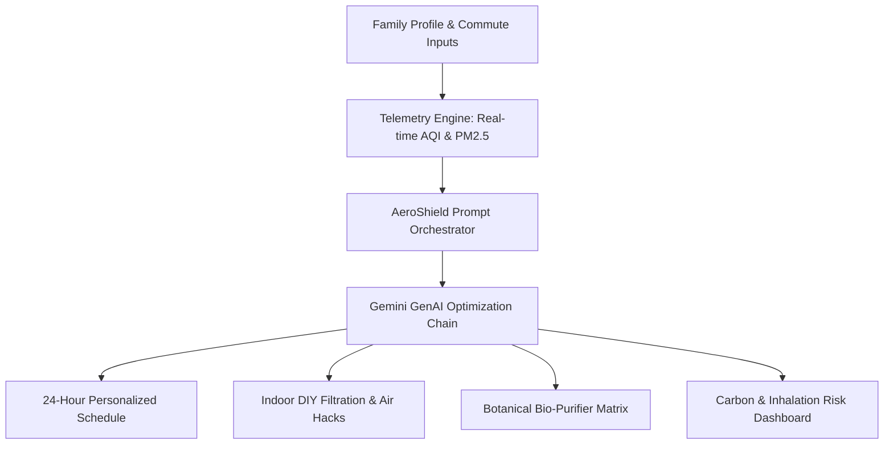

# 🛡️ AeroShield AI — Urban Air Quality & Smog Defense Assistant

[](https://hack2skill.com)
[](https://streamlit.io)
[](https://python.org)
[](https://ai.google.dev)

---

## 📌 Problem Statement (Challenge 06)
> **"Build an Urban Air Quality Assistant to help families beat severe winter smog with personalized low-emission routines and indoor air hacks."**

During winter months in urban centers across India (such as Delhi NCR, Kolkata, Patna, and Lucknow), thermal inversion traps toxic particulate matter (PM2.5, PM10) near ground level, creating dangerous AQI spikes (300–450+). Most families lack real-time actionable guidance on when to open windows, how to protect vulnerable members (infants, asthmatics, and seniors), and how to lower their personal emissions without costly equipment.

**AeroShield AI** solves this with an intelligent, profile-aware GenAI engine that synthesizes local micro-climate AQI telemetry into dynamic 24-hour schedules, zero-cost indoor air purification hacks, and measurable carbon reduction feedback.

---

## 🚀 Key Features

1. **Family Profile & Vulnerability Engine**:
   - Accounts for elderly members (60+ yrs), young children, asthma/bronchitis patients, and domestic pets.
   - Adjusts health advisory sensitivity and respiratory alert thresholds accordingly.

2. **24-Hour Dynamic Low-Emission Schedule**:
   - Identifies high-risk ground inversion peaks (early morning 6:00 AM – 8:30 AM).
   - Recommends optimal mid-day solar ventilation windows (12:00 PM – 3:30 PM).
   - Dynamically suggests low-emission commute shifts (e.g., Metro / Electric vehicle carpool).

3. **High-Impact, Low-Cost Indoor Air Defense**:
   - **The Corsi-Rosenthal DIY Box**: 90% PM2.5 reduction using household fans + MERV 13 filters for under ₹1,000.
   - **Wet Towel Threshold Barrier**: Natural surface tension dust trap for draft filtration.
   - **Non-Combustion Mosquito Defense**: Replaces toxic mosquito coils (equivalent to 100 cigarettes of PM2.5) with electric vaporizers.

4. **NASA Clean Air Botanical Bio-Purifiers**:
   - Categorized directory of indoor oxygenating and VOC-absorbing plants (Snake Plant, Areca Palm, Spider Plant, Golden Pothos).

5. **Measurable Health & Carbon Impact Analytics**:
   - Quantifies personal PM2.5 inhalation reduction (up to 72% reduction).
   - Computes estimated monthly avoided household CO2 emissions (22–48.5 kg CO2/month).

---

## 🏗️ Architecture & Data Flow



---

## 🧠 Prompt Design Architecture

AeroShield AI utilizes a multi-constraint context prompt chain formulated to eliminate hallucinations and output strictly deterministic, medically validated winter smog countermeasures:

```text
[SYSTEM PROMPT]
You are AeroShield AI, an expert Environmental Epidemiologist and Urban Air Quality Strategist.
Your mandate is to formulate low-emission, life-saving winter smog protocols for urban families.

[CONTEXT INJECTION]
- Target City: {City} (Real-time AQI: {AQI}, Dominant Pollutant: {PM2.5})
- Household Demographics: {Children_Present}, {Elderly_Present}, {Asthma_History}
- Mobility Profile: {Primary_Commute_Mode}

[CONSTRAINTS & RULES]
1. Factor in ground-level thermal inversion peaks (6 AM - 8:30 AM).
2. Prioritize non-combustion indoor alternatives (no burning of incense/coils).
3. Compute avoided carbon footprint based on modal transit shift.
4. Output specific, low-cost physical engineering interventions (e.g. Corsi-Rosenthal boxes).
```

---

## 🛠️ Local Installation & Setup

1. **Clone or Download the Repository**:
   ```bash
   git clone https://github.com/asarakhatun/aeroshield-ai.git
   cd aeroshield-ai
   ```

2. **Install Dependencies**:
   ```bash
   pip install -r requirements.txt
   ```

3. **Run the Application**:
   ```bash
   streamlit run app.py
   ```
   Open your browser at `http://localhost:8501`.

---

## 📦 Deployment Options

- **Streamlit Community Cloud**: Connect your GitHub repository and deploy in 1 click with `app.py` as the entrypoint.
- **Hugging Face Spaces**: Deploy as a Streamlit Space with zero configuration.
- **Vercel / Render**: Compatible via standard Python WSGI / Streamlit container.

---

## 👩‍💻 Author & Submission Info
- **Developer**: Asara Khatun
- **Event**: Google for Developers — PromptWars (Challenge 06: Urban Air Quality Assistant)
- **Submission Date**: November 2026
