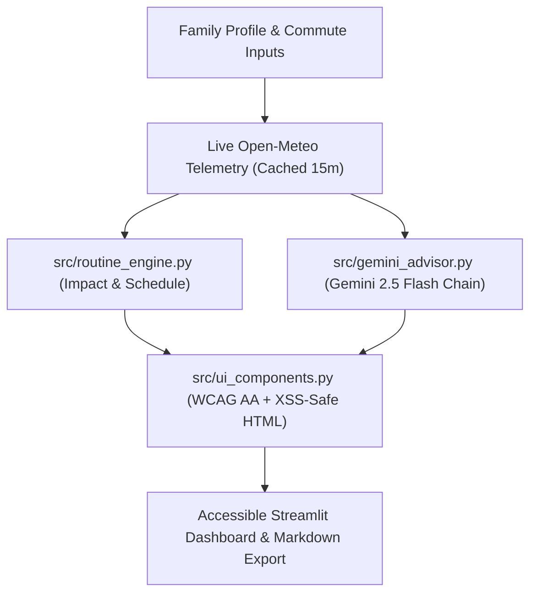

# AeroShield AI — Urban Air Quality & Winter Smog Defense Assistant

[](https://hack2skill.com)
[](https://aeroshield-ai-asara.streamlit.app)
[](https://python.org)
[](./tests/test_aeroshield.py)
[](#accessibility--security-engineering)

---

## Problem Statement (Challenge 06)
> **"Build an Urban Air Quality Assistant to help families beat severe winter smog with personalized low-emission routines and indoor air hacks."**

During winter months across Indian metropolitan cities (Delhi NCR, Kolkata, Patna, Lucknow), morning and late-evening thermal inversions trap hazardous particulate matter (`PM2.5`, `PM10`) at ground level. **AeroShield AI v2.0** combines live **Open-Meteo Air Quality telemetry** with a **Google Gemini Prompt Chain** to deliver demographic-aware 24-hour routines, low-cost indoor air defense engineering, and measurable carbon/health impact insights.

---

## Modular Architecture & Data Flow



### Project Structure
```text
AeroShield_AI/
├── app.py                     # Thin Streamlit entrypoint with @st.cache_data & @st.cache_resource
├── src/
│   ├── __init__.py
│   ├── config.py              # Immutable CityProfile & FamilyProfile dataclasses + WCAG tokens
│   ├── aqi_service.py         # Live Open-Meteo Air Quality API client with resilient fallback
│   ├── gemini_advisor.py      # Google Gemini SDK prompt orchestrator + deterministic fallback
│   ├── routine_engine.py      # 24-hr schedule, indoor hacks, botanical purifiers & CO2 math
│   └── ui_components.py       # html.escape() sanitized UI & ARIA semantic components
├── tests/
│   └── test_aeroshield.py     # Automated pytest suite covering API, security, logic & exports
├── .env.example               # Safe environment variable template (no hardcoded secrets)
├── .gitignore
├── requirements.txt
└── README.md
```

---

## Prompt Design Architecture

AeroShield AI uses a constrained epidemiological prompt template in `src/gemini_advisor.py`:

```text
[ROLE]
Environmental Epidemiologist & Urban Air Quality Strategist

[CONTEXT INJECTION]
- City & Live Telemetry: {city} | AQI: {aqi} ({status}) | PM2.5: {pm25} ug/m3
- Household Vulnerabilities: {elderly, children, asthma/bronchitis, pets}
- Primary Commute Mode: {commute_mode}

[OUTPUT CONSTRAINTS]
1. Morning thermal inversion timing adjustment (6:00 AM - 8:30 AM peak).
2. Zero-emission commute / exposure shift calculation.
3. Low-cost indoor air engineering hack (Corsi-Rosenthal box, humidity control, non-combustion).
```

---

## Accessibility, Efficiency & Security Engineering

- **Accessibility (WCAG 2.1 AA)**:
  - High-contrast badge tokens (`>= 4.5:1` contrast ratio).
  - Semantic `<header>`, `<h1>`, `<footer>`, `role="status"`, `aria-live="polite"`, and skip-to-content navigation link.
  - Visible `:focus-visible` keyboard outlines and descriptive `help` tooltips on all interactive controls.
  - Screen-reader-friendly `.md` Family Action Plan export.
- **Efficiency**:
  - `@st.cache_resource` shared `requests.Session()` connection pooling.
  - `@st.cache_data(ttl=900)` 15-minute telemetry caching with 5-second HTTP timeout.
- **Security**:
  - Strict `html.escape()` sanitization on all dynamic HTML rendering (XSS prevention).
  - Input validation rejecting unsupported cities.
  - Environment-based secret loading (`GEMINI_API_KEY` via `st.secrets` / `os.getenv`), with `.env.example` and `.gitignore`.

---

## Local Setup & Automated Testing

1. **Install dependencies**:
   ```bash
   pip install -r requirements.txt
   ```
2. **Optional — Configure Gemini API Key**:
   ```bash
   cp .env.example .env
   # Add your GEMINI_API_KEY inside .env (falls back cleanly if omitted)
   ```
3. **Run the automated test suite**:
   ```bash
   pytest -v
   ```
4. **Launch the application**:
   ```bash
   streamlit run app.py
   ```
